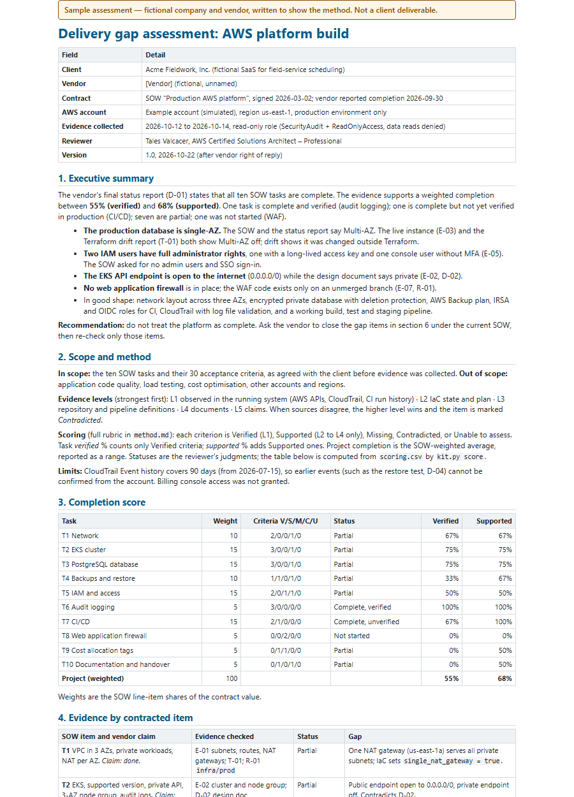
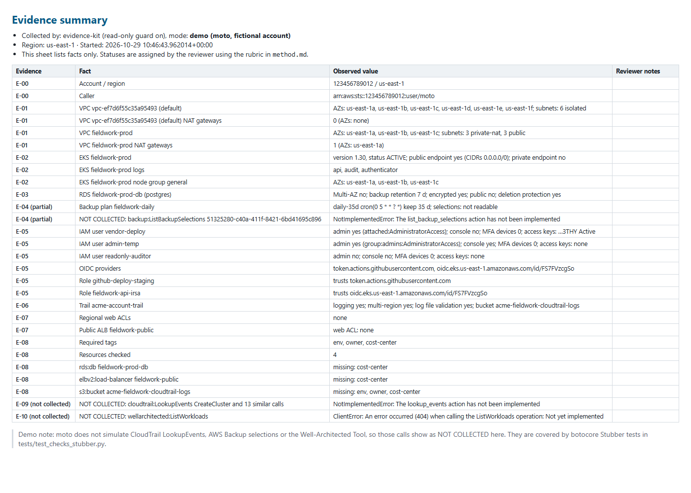
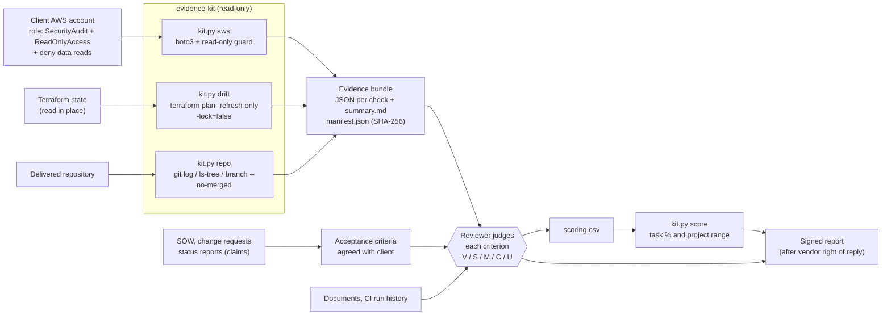

# AWS delivery gap assessment: method, evidence kit and sample report

> "Independently determine what was actually implemented and completed, identify gaps between contracted scope and observable technical evidence, and quantify completion at both the task and overall project level."

This repository is how I do that for AWS work: a written **method**, a small **read-only evidence kit** (Python + boto3, tested offline), and a **sample report** about a fictional company and vendor that shows the output.

> **Honesty note.** This is an open-source method and demo, not a record of a client engagement. The sample report describes a fictional company (Acme Fieldwork, Inc.) and a fictional, unnamed vendor. Its account data is simulated.



## What it does

- **Turns the SOW into checkable acceptance criteria** and scores each one as Verified, Supported, Missing, Contradicted or Unable to assess, with a clear rule for each ([method.md](method.md#5-completion-scoring-rubric)).
- **Ranks evidence**: what is observed running in the AWS account beats IaC state, which beats the repository, which beats documents, which beat claims.
- **Collects AWS evidence read-only**: VPC and NAT layout, EKS/ECS, RDS Multi-AZ and backups, AWS Backup, IAM admins/MFA/keys/OIDC roles, CloudTrail, WAF on public load balancers, required tags, CloudTrail change events, Well-Architected Tool workloads. Every file is hashed in a manifest.
- **Compares Terraform with reality** (`plan -refresh-only` for changes made outside Terraform, `plan` for code that does not match what runs), keeping attribute names but never values.
- **Reads the delivery record** from a git clone: commits in the contract window, tags, CI/CD files, IaC folders and unmerged branches.
- **Computes task and project completion as a range** (verified to supported) from the reviewer's scoring CSV, so every number in a report can be re-checked.

The scripts collect facts. **Every status, finding and recommendation is a judgment made and signed by the reviewer.** The kit has no AI component.



*Screenshot: `kit.py demo` output (moto-simulated fictional account, offline). The empty "Reviewer notes" column is deliberate.*

## Architecture



## Quick start

Python 3.10+ (tested on 3.13). No AWS account or credentials needed: the demo and the tests run offline.

```bash
python -m venv .venv && . .venv/bin/activate      # Windows: .venv\Scripts\activate
pip install -r requirements-dev.txt
python evidence-kit/kit.py demo --out out/demo && pytest
```

The demo writes `out/demo/summary.md`, one JSON file per check and `manifest.json`. `pytest` runs the full suite: moto for the simulated account, botocore Stubber for APIs moto does not cover, a temporary git repository for the delivery record, and a real `terraform plan` of a built-in resource when Terraform is installed.

Rebuild the sample report (score table, HTML and PDF through headless Edge or Chrome):

```bash
python sample-report/build.py          # add --no-pdf if no Edge/Chrome is installed
```

Real-account usage, IAM templates and the drift check: [evidence-kit/README.md](evidence-kit/README.md).

## Repository map

| Path | What it is |
|---|---|
| [`method.md`](method.md) | Inputs requested, evidence hierarchy, procedure, scoring rubric, AWS evidence catalogue, independence and human-led review statement |
| [`sample-report/gap-assessment.pdf`](sample-report/gap-assessment.pdf) | Three-page sample report (fictional), also as [Markdown](sample-report/gap-assessment.md) |
| [`sample-report/scoring.csv`](sample-report/scoring.csv) | The per-criterion statuses behind the sample's numbers |
| [`evidence-kit/`](evidence-kit/) | `kit.py` (aws, drift, repo, score, demo), IAM templates, docs |
| [`docs/demo-evidence/`](docs/demo-evidence/) | One saved run of the offline demo |
| [`tests/`](tests/) | pytest suite, no network |

## How it fails safely

- **It cannot write to AWS.** Access is a client-created role with read-only managed policies and an explicit deny on data reads (objects, secrets, parameters, table items, log events). In code, a guard checks every boto3 call before the request is built and blocks anything that is not `Describe/List/Get/Lookup/Search`, plus data reads like `GetObject` and `GetSecretValue` and calls that hand out credentials, such as `GetAuthorizationToken`. Tests prove a blocked write never reaches the (simulated) account.
- **It cannot change Terraform state or git history.** The drift wrapper only runs `init`, `plan`, `show` and `version`, refuses `-auto-approve` and `-destroy`, and requires `-lock=false`. The git wrapper only runs read commands.
- **Missing access is never a finding.** A call that fails is written as `NOT COLLECTED` with the error, and a check that collected nothing never prints "none found". In the report, the reviewer marks such criteria *Unable to assess*, which counts as not delivered and is listed in the scope limits.
- **No secrets in the evidence.** Access key IDs are cut to four characters; drift output lists attribute names, never values; Terraform state is read in place and not copied.
- **A person decides.** Scripts do not assign statuses. The vendor sees the draft and can answer with evidence before the report is signed.

## Design decisions and trade-offs

- **Facts and judgments are separate files.** The kit writes facts; the reviewer writes `scoring.csv`. This keeps the judgment auditable and makes it clear what a tool did and what a person decided.
- **A completion range, not one number.** "Verified" counts only what was seen running; "supported" adds what exists in code and documents. One number would hide exactly the part a client is paying to find out.
- **Contradicted is not the same as Missing.** Both score zero, but a contradiction means a claim was wrong, which matters for the client's next conversation with the vendor.
- **Direct API reads instead of a posture scanner.** Posture tools answer "is this account following best practice?". This question is "was the contract delivered?", so checks map to SOW items, and they work in any account with only the read-only role (no AWS Config or Security Hub required).
- **moto plus Stubber.** moto gives a realistic simulated account for most checks; Stubber covers the APIs moto does not implement. Stubber validates request and response shapes against the botocore service models.
- **Small and boring on purpose.** Plain Python, boto3 and the standard library, so a client's own engineer can read every line that touched their account.

## Limits

- **Not run against a real AWS account in this repository.** All AWS behaviour in the tests is simulated (moto) or canned (Stubber). Real accounts can differ in pagination, regional quirks and permission errors.
- **CloudTrail `LookupEvents`, AWS Backup selections and the Well-Architected Tool** are only tested with Stubber; the offline demo shows them as `NOT COLLECTED` because moto does not implement them.
- **The drift parser** is tested on a hand-written JSON plan fixture (following Terraform's documented JSON plan format) and on a real plan of a `terraform_data` resource, not on a real AWS state.
- **The IAM templates were not applied to a real account**; review them with the client's security team before use.
- **Scope of the checks:** one account and one region per run; no AWS Organizations traversal; WAF checks cover regional web ACLs on internet-facing ALBs (not CloudFront or API Gateway); admin detection covers `*:*` policies and `AdministratorAccess`, not privilege-escalation paths, permission boundaries or SCPs; tag checks cover six resource types.
- **CI/CD run history** comes from an export the client provides; there is no CI system API integration.
- **The sample report** is fictional. Its statuses were written to show the method, and its numbers come from `scoring.csv`.

## Adapting this to your stack

- **Different SOW items:** add a function to `CHECKS` in `evidence-kit/evidence_kit/checks.py` that returns facts (no verdicts), and a formatter in `summary.py`. Add a moto or Stubber test.
- **CloudFormation or CDK instead of Terraform:** use the stack's drift status and the change set of the delivered template. Starting drift detection is an API action, so the client runs it, or it is allowed explicitly in the role.
- **ECS instead of EKS:** ECS clusters are already collected; add service-level reads (`DescribeServices`) for desired vs. running tasks.
- **Several accounts:** one reviewer role per account and one run per account and region, each into its own evidence folder.
- **GitLab, Bitbucket, CodeCommit:** `kit.py repo` works on any git clone and already recognises GitLab, Bitbucket, CodeBuild and Jenkins CI files.

## License

MIT, see [LICENSE](LICENSE).
